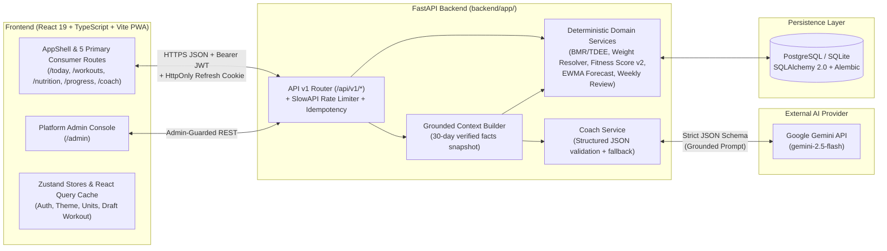

# FitMind AI — System Architecture

## 1. High-Level System Architecture

---

## 2. Frontend Architecture (`src/`)

- **Navigation & Layout (`src/components/layout/AppShell.tsx`):**
  - Desktop left sidebar (`240px`) and mobile bottom navigation bar (`64px`) with 5 primary destinations: **Today** (`/today`), **Workouts** (`/workouts`), **Nutrition** (`/nutrition`), **Progress** (`/progress`), and **Coach** (`/coach`), plus **Settings** (`/settings`) in the account menu.
  - Platform Admin (`/admin`) uses a dedicated administrative layout guarded by `AdminRoute` (`is_admin === true`).
- **Design Token System (`src/styles/design-tokens.css` & `tailwind.config.js`):**
  - Supports Light (`[data-theme="light"]`), Dark (`[data-theme="dark"]`), and System themes via semantic CSS custom properties (`--bg`, `--surface`, `--surface-2`, `--border`, `--text`, `--text-2`, `--text-3`, `--accent`, `--success`, `--warning`, `--danger`).
  - Uses `Plus Jakarta Sans` (`font-sans`) for UI and `JetBrains Mono` (`font-mono`) with `tabular-nums` for weights, macros, timers, and scores.
- **Offline & PWA (`vite.config.ts`, `src/store/useWorkoutDraftStore.ts`):**
  - Active workout sessions persist every set edit to `localStorage` (`fitmind-active-workout-v1`) and submit with a deterministic `Idempotency-Key` header so network retries never duplicate workout logs.
  - Workbox precaches static shell assets while `navigateFallbackDenylist: [/^\/api/]` ensures authenticated API responses are never cached in the service worker.

---

## 3. Backend Architecture (`backend/app/`)

- **Layered Service Pattern:**
  - `api/v1/`: Thin FastAPI route controllers handling request validation, dependency injection (`get_current_user`, `get_current_admin`), rate limiting, and HTTP status codes.
  - `services/`: Deterministic domain logic:
    - `weight_resolver.py`: Single source of truth for current weight (`latest Measurement.weight_kg` -> `Profile.weight_kg` -> `None`).
    - `bmr_service.py`: Mifflin-St Jeor BMR, TDEE, goal calorie adjustments, protein scaling (`1.8–2.0 g/kg`), and safety floors (`1200 kcal` female / `1500 kcal` male / `1350 kcal` other).
    - `fitness_score_service.py`: Formula v2 (`formula_version = 2`) weighting Workout Adherence (35%), Calorie Adherence (25%), Protein Adherence (20%), and Logging Consistency (20%), with weight-redistribution when no active workout plan exists.
    - `intelligence_service.py`: EWMA weight trend (`alpha = 0.3`), linear regression projection (`>= 4` weigh-ins over `>= 7` days), physiological guardrails (`[-1.0, +0.5] kg/week`), and goal-aligned trajectory status (`on_track`, `ahead`, `behind`, `off_track`).
    - `report_service.py`: Instant deterministic 7-day and 30-day reviews (`ai=False` default) with period-over-period deltas, plus on-demand `POST /api/v1/reports/ai-summary`.
    - `context_builder.py` & `coach_service.py`: Builds `GroundedFactsContext` and validates structured LLM replies (`CoachReply`).

---

## 4. Database Schema & Migrations (`backend/alembic/`)

All schema changes are managed through Alembic (`backend/alembic/versions/`, current head `2026_10_11_0016`):
- **Core Identity & Goals:** `users` (with `is_admin`, `last_active_at`), `refresh_tokens`, `profiles` (with `timezone`, `target_workout_days_per_week`), `goals`.
- **Training:** `exercises` (with `is_verified`), `workout_plans`, `workout_plan_exercises`, `workout_logs` (with `idempotency_key`), `workout_log_exercises`.
- **Nutrition:** `foods` (174-item catalog with `serving_name`, `serving_grams`, `category`), `meal_logs`, `meal_log_items`.
- **Progress & AI:** `measurements` (unique `(user_id, measured_at)`), `fitness_scores` (with `formula_version`, `explanation`), `ai_memories`, `chat_messages`, `admin_audit_log`.
